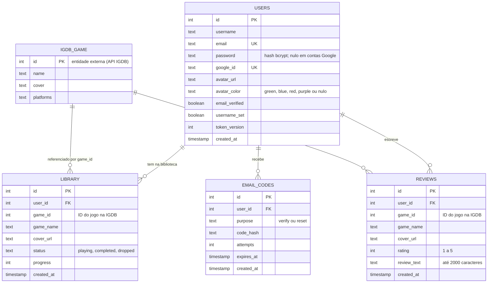

# Modelo de Dados — Playboxd

Banco **PostgreSQL** (hospedado no Neon), acessado apenas pelo backend Node.js em [`backend/backend/server.js`](backend/backend/server.js).
O script completo de criação e migração está em [`backend/backend/schema.sql`](backend/backend/schema.sql).

## Diagrama entidade-relacionamento

> **IGDB_GAME não é uma tabela do banco.** Os jogos vêm da API externa [IGDB](https://api-docs.igdb.com/) (Twitch).
> O banco guarda só o `game_id` e uma cópia do nome e da capa (`game_name`, `cover_url`) para exibir a biblioteca e as reviews sem consultar a API.

## Relacionamentos

| Relacionamento | Cardinalidade | Regra |
| --- | --- | --- |
| `users` → `library` | 1 : N | Um usuário tem vários jogos na biblioteca; cada jogo aparece **uma vez** por usuário (`UNIQUE (user_id, game_id)`) |
| `users` → `reviews` | 1 : N | Um usuário escreve várias reviews; **uma** por jogo (`UNIQUE (user_id, game_id)`) |
| `users` → `email_codes` | 1 : N | Códigos de verificação de e-mail e de recuperação de senha |
| Exclusão de conta | — | `ON DELETE CASCADE`: apagar o usuário apaga biblioteca, reviews e códigos |

## Dicionário de dados

### `users` — contas
| Coluna | Tipo | Restrição | Descrição |
| --- | --- | --- | --- |
| `id` | SERIAL | PK | Identificador |
| `username` | TEXT | NOT NULL | Nome exibido no app |
| `email` | TEXT | NOT NULL, UNIQUE | E-mail de login |
| `password` | TEXT | — | Hash bcrypt da senha; nulo em contas só com Google |
| `google_id` | TEXT | UNIQUE | ID da conta Google, quando usa login Google |
| `avatar_url` | TEXT | — | Foto da conta Google (reservado) |
| `avatar_color` | TEXT | — | Cor do avatar: `green`, `blue`, `red`, `purple` ou nulo (inicial padrão) |
| `email_verified` | BOOLEAN | NOT NULL, padrão `false` | Contas por e-mail só entram após confirmar o código |
| `username_set` | BOOLEAN | NOT NULL, padrão `true` | `false` quando a conta Google ainda não escolheu o nome |
| `token_version` | INTEGER | NOT NULL, padrão `0` | Vai no token JWT; somar 1 encerra todas as sessões (ex.: ao redefinir a senha) |
| `created_at` | TIMESTAMP | padrão `NOW()` | Data de cadastro |

### `library` — biblioteca de jogos
| Coluna | Tipo | Restrição | Descrição |
| --- | --- | --- | --- |
| `id` | SERIAL | PK | Identificador |
| `user_id` | INTEGER | FK → `users.id` | Dono da biblioteca |
| `game_id` | INTEGER | NOT NULL | ID do jogo na IGDB |
| `game_name` | TEXT | NOT NULL | Nome do jogo (cópia) |
| `cover_url` | TEXT | — | Capa do jogo (cópia) |
| `status` | TEXT | NOT NULL | `playing`, `completed` ou `dropped` |
| `progress` | INTEGER | padrão `0` | Progresso do jogo |
| `created_at` | TIMESTAMP | padrão `NOW()` | Data em que foi adicionado |

### `reviews` — avaliações
| Coluna | Tipo | Restrição | Descrição |
| --- | --- | --- | --- |
| `id` | SERIAL | PK | Identificador |
| `user_id` | INTEGER | FK → `users.id` | Autor |
| `game_id` | INTEGER | NOT NULL | ID do jogo na IGDB |
| `game_name` | TEXT | NOT NULL | Nome do jogo (cópia) |
| `cover_url` | TEXT | — | Capa do jogo (cópia) |
| `rating` | INTEGER | NOT NULL, `CHECK 1–5` | Nota |
| `review_text` | TEXT | — | Texto da review (até 2000 caracteres, validado na API) |
| `created_at` | TIMESTAMP | padrão `NOW()` | Data da review |

### `email_codes` — códigos por e-mail
| Coluna | Tipo | Restrição | Descrição |
| --- | --- | --- | --- |
| `id` | SERIAL | PK | Identificador |
| `user_id` | INTEGER | NOT NULL, FK → `users.id` | Dono do código |
| `purpose` | TEXT | NOT NULL | `verify` (confirmar e-mail) ou `reset` (redefinir senha) |
| `code_hash` | TEXT | NOT NULL | Hash do código de 6 dígitos (o código nunca é salvo em texto) |
| `attempts` | INTEGER | NOT NULL, padrão `0` | Tentativas erradas |
| `expires_at` | TIMESTAMP | NOT NULL | Validade do código |
| `created_at` | TIMESTAMP | NOT NULL, padrão `NOW()` | Data de envio |

## Índices

| Índice | Tabela | Colunas | Finalidade |
| --- | --- | --- | --- |
| `library_user_game_unique` | `library` | `user_id, game_id` | Impede jogo repetido na biblioteca |
| `reviews_user_game_unique` | `reviews` | `user_id, game_id` | Uma review por jogo |
| `idx_reviews_user_id` | `reviews` | `user_id` | Listar as reviews de um usuário |
| `email_codes_user_purpose_idx` | `email_codes` | `user_id, purpose` | Buscar o código ativo do usuário |

> Colunas legadas ainda presentes no banco e não usadas pelo código: `library.game_image`, `reviews.game_image` e `reviews.review` (substituídas por `cover_url` e `review_text`).
